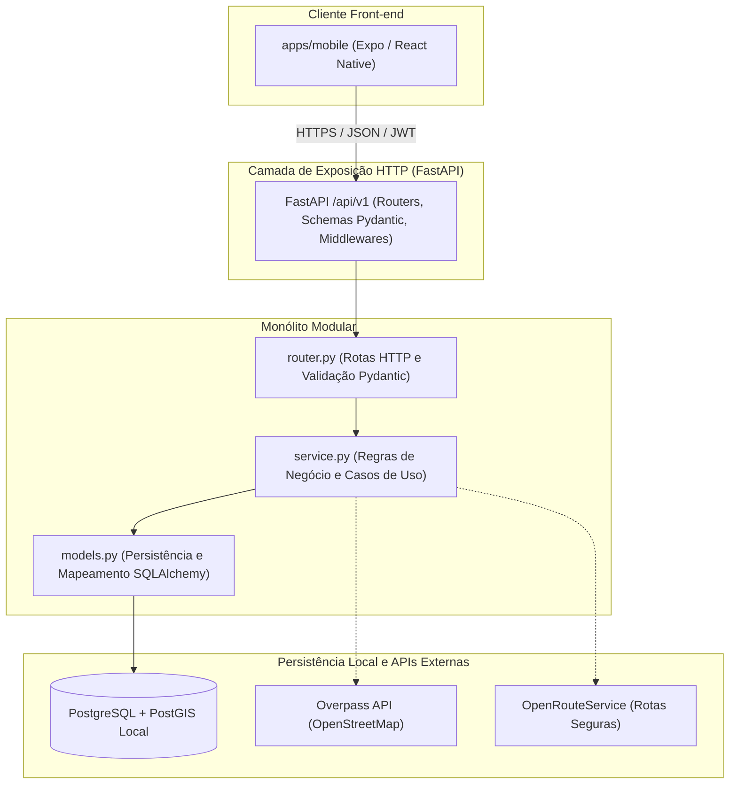

# Arquitetura do Sistema ProtegEla

O **ProtegEla** é uma plataforma colaborativa voltada à segurança de mulheres em deslocamentos urbanos, com foco inicial na cidade de São Paulo.

Este documento formaliza as decisões arquiteturais, a separação de responsabilidades e as diretrizes estruturais do projeto.

---

## 1. Visão Geral da Arquitetura

O sistema adota o padrão **Cliente-Servidor**, estruturado em um **Monorepo** para facilitar o compartilhamento de tipos, documentação e contratos, mantendo o **Back-end como um Monólito Modular**.

---

## 2. Organização do Back-end (FastAPI Monolítico Modular)

O back-end é estruturado dentro de `backend/src/` com base em **Módulos Verticais Diretos** para garantir clareza e facilidade de manutenção para equipes de desenvolvimento:

### 2.1. Estrutura Padrão por Módulo (`backend/src/modules/<modulo>/`)

Cada módulo funcional possui uma divisão direta de responsabilidades em arquivos:
- **`router.py`**: Define os endpoints do FastAPI (`APIRouter`), validação de entrada/saída com Pydantic e códigos de status HTTP.
- **`service.py`**: Implementa as regras de negócio puras, cálculos de risco e chamadas a serviços externos.
- **`models.py`**: Declara as tabelas e relacionamentos ORM do SQLAlchemy herdados de `Base`.
- **`README.md`**: Documenta os requisitos funcionais associados ao módulo e instruções específicas.

### 2.2. Módulos de Negócio Mantidos

| Módulo | Responsabilidade | Requisitos Relacionados |
| :--- | :--- | :--- |
| **`auth`** | Autenticação, tokens JWT, recuperação de senha e acesso sem login. | RF01, RF02, RF04, RF16, RN08 |
| **`users`** | Perfil, preferências e contatos de emergência criptografados. | RF01, RF17, RNF06, RNF07 |
| **`reports`** | Criação, confirmação e denúncia de incidentes (assédio, furto, iluminação, violência). | RF06, RF08, RF09, RN05, RN06 |
| **`comments`** | Comentários e respostas encadeadas nos relatos de perigo. | RF07, RF08 |
| **`risk_zones`** | Agrupamento espacial (raio 20m), pontuação de risco e amortização temporal. | RF06, RN01, RN02, RN03, RN05 |
| **`routes`** | Integração com OpenRouteService para rota de pedestres com desvio de risco. | RF15, RN04, RN07, RNF10 |
| **`emergency`** | Acionamento de pânico e lista de telefones úteis (180, 190). | RF10, RF14, RNF09 |
| **`support_locations`** | Delegacias e hospitais próximos via Overpass API (OSM). | RF12, RNF10 |
| **`notifications`** | Alertas de proximidade de áreas de risco e avisos locais. | RF13, RNF04 |

### 2.3. Núcleo Compartilhado (`backend/src/core/`)

- `config.py`: Gestão de variáveis de ambiente com Pydantic Settings.
- `database.py`: Criação da engine assíncrona do SQLAlchemy (`asyncpg`) e session factory.
- `exceptions.py`: Exceções de negócio e manipuladores de erro retornando o envelope RFC 7807.
- `security.py`: Validação de senha forte (RN08), hash Argon2id, JWT e criptografia Fernet (RNF06).

---

## 3. Organização do Front-end Mobile (`apps/mobile`)

O aplicativo móvel é construído em **React Native com Expo** utilizando **Expo Router**:

- `app/`: Rotas do aplicativo (`_layout.tsx`, `index.tsx`).
- `src/components/`: Componentes visuais (`ui/Button.tsx`, `feedback/RiskBadge.tsx`).
- `src/features/`: Módulos de negócio no cliente (`auth`, `map`, `reports`, `routes`, `emergency`, `profile`).
- `src/services/api/`: Cliente Axios centralizado com interceptor de tokens e tratamento de erros.
- `src/storage/`: Wrappers seguros para tokens (`secureStore.ts`) e cache offline (`localStorage.ts`).
- `src/theme/`: Tokens de cores com alto contraste (RNF08), tipografia e espaçamentos.

---

## 4. Persistência de Dados e Suporte Geoespacial

- **PostgreSQL Local**: Executado localmente por cada integrante na porta `5432`.
- **Extensão PostGIS**: Ativada no banco `protegela_db` para cálculos espaciais (`ST_DWithin`, `ST_Distance`).
- **Migrações com Alembic**: Gerenciamento de alterações no schema de forma rastreável no Git.
