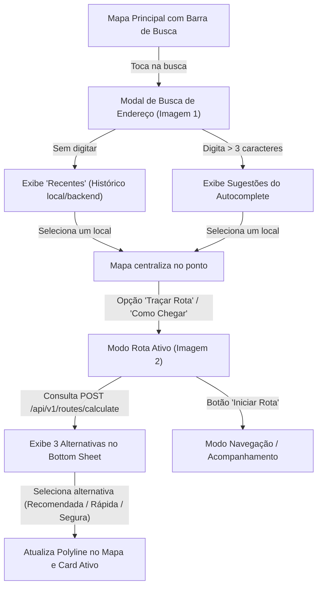

# Plano de Execução: Rotas Seguras e Histórico de Buscas (RF15 & RF04)

Este documento detalha o planejamento da interface, da experiência do usuário (UX) e da integração com o backend para o **Módulo de Rotas Seguras** e a tela de **Busca com Recentes**, com base nos designs enviados.

---

## 1. Fluxo de Navegação e UX

---

## 2. Análise do Backend Atual vs Requisitos

### 2.1. O Backend já calcula as 3 rotas?
**Sim!** O endpoint `POST /api/v1/routes/calculate` já está implementado e integrado à base:
1. **Geração das alternativas**: Consulta o OpenRouteService (`client.alternatives`) para gerar até 3 trajetos geométricos a pé contínuos.
2. **Cálculo de Risco**: O `RouteRiskEvaluator` cruza a geometria de cada rota com o histórico de manchas criminais e relatos comunitários da base PostgreSQL/PostGIS.
3. **Classificação das 3 opções**:
   - **Mais rápida (`fastest_route_id`)**: A rota de menor tempo em segundos.
   - **Mais segura (`lower_risk_route_id`)**: A rota com menor índice de risco exposto.
   - **Recomendada**: A alternativa que equilibra segurança e tempo viável.
4. **Regra dos 30% de desvio (RN04)**: O backend já calcula `exceeds_30_percent` (`lowest.duration_s > 1.30 * fastest.duration_s`). Se a rota segura for mais de 30% mais longa que a mais rápida, o sistema avisa a usuária.
5. **Geometria pronta**: O backend devolve o GeoJSON `LineString` com todas as coordenadas `[lon, lat]` de cada rota prontas para renderizar no mapa.

### 2.2. E o Histórico de Recentes?
- O backend possui o módulo `backend/src/modules/history`:
  - `POST /api/v1/users/me/search-history` (salva busca com label)
  - `GET /api/v1/users/me/search-history` (lista últimas buscas)
  - `POST /api/v1/users/me/route-history` (salva rota percorrida)
  - `GET /api/v1/users/me/route-history` (lista rotas concluídas)
- **Estratégia híbrida (RF04)**:
  - No mobile, usamos o `AsyncStorage` local para que os **Recentes** apareçam instantaneamente (0ms de latência), mesmo para usuárias deslogadas.
  - Para usuárias autenticadas, sincronizamos em background com o backend.

---

## 3. Fases de Execução

### Fase 1: Tela de Busca Expandida com Recentes (Imagem 1)
- [ ] Criar o componente `AddressSearchModal.tsx` ou expandir a busca do topo:
  - Input com ícone de lupa e botão `[ ✕ ]` de fechar.
  - Seção **"Recentes"** com ícone de histórico (duas setas circulares).
  - Card de item recente contendo título principal em negrito e subtítulo com rua/bairro.
  - Leitura e persistência automática dos últimos 5 endereços no `AsyncStorage`.
  - Ao clicar em um recente, preenche e seleciona o local diretamente.

### Fase 2: Gatilho de Entrada no "Modo Rota"
- [ ] Ao selecionar um endereço pelo campo de busca:
  - O mapa posiciona o marcador roxo de destino.
  - Surge um card flutuante ou botão de ação rápida: **"Traçar Rota"** (com botão "Fechar" se quiser apenas ver o local).
  - Ao clicar em **"Traçar Rota"**, o estado do mapa muda para `routeMode = true`.

### Fase 3: Interface do Modo Rota (Imagem 2)
- [ ] **Card Flutuante Superior de Origem/Destino**:
  - Ponto de Origem: "Localização Atual" (com ponto roxo e seta conectando).
  - Ponto de Destino: Nome do local selecionado.
  - Botão `✕` para sair do modo rota e botão `✏` para editar locais.
  - Botão flutuante roxo **"Iniciar rota"**.
- [ ] **Bottom Sheet de Opções de Rota ("Rotas")**:
  - Exibição de 3 cards selecionáveis:
    1. **Recomendada**: Tag verde escuro, tempo estimado (ex: 23 min 🚶), distância (ex: 2,5 km) e badge "Risco baixo" (verde).
    2. **Mais rápida**: Tag azul-petróleo, tempo estimado (ex: 18 min 🚶), distância (ex: 1,9 km) e badge "Risco médio" (laranja).
    3. **Mais segura**: Tag roxa, tempo estimado (ex: 25 min 🚶), distância (ex: 2,6 km) e badge "Risco baixo" (verde).
  - Borda roxa de destaque no card selecionado no momento.

### Fase 4: Renderização das Linhas no Mapa (`Polyline`)
- [ ] Integração das coordenadas da rota ativa com o componente `<Polyline>`:
  - Rota ativa desenhada com traço sólido roxo/azul e maior espessura (`strokeWidth: 4`).
  - Rotas alternativas desenhadas em segundo plano com traço mais sutil ou cinza/pontilhado.
  - Marcador de destino com pino estilizado.
  - Ajuste dinâmico do zoom do mapa (`fitToCoordinates`) para enquadrar a usuária e o destino juntos na tela.

---

## 4. Glossário Rápido das APIs do OpenRouteService (ORS)

| Serviço da API ORS | O que faz no mundo real | No ProtegEla |
| :--- | :--- | :--- |
| **Directions v2** | Calcula o caminho passo a passo de A até B (para pedestres, carros ou bicicletas), retornando tempo, distância e as linhas para desenhar no mapa. | **Usado no cálculo de rotas seguras (RF15).** |
| **Geocoding / Pelias** | Transforma texto digitado ("Av. Paulista, 1000") em coordenadas `[latitude, longitude]`. | **Usado na busca preditiva de endereços.** |
| **Isochrones v2** | Desenha uma "mancha" no mapa mostrando até onde uma pessoa consegue chegar andando em 5, 10 ou 15 minutos. | Muito útil para análises de refúgio e tempo de fuga até um ponto seguro. |
| **Matrix v2** | Calcula uma tabela de distâncias e tempos entre múltiplos pontos de uma só vez (ex: de 1 usuário para 10 delegacias em 1 requisição só). | Alternativa de altíssima eficiência para consultas em lote. |
| **Elevation** | Informa a altimetria do terreno (se o caminho tem subidas muito íngremes ou descidas). | Pode enriquecer a acessibilidade da rota de pedestres. |
| **Snap** | Pega uma coordenada imprecisa de GPS e "prende" na calçada ou rua asfaltada mais próxima. | Garante que rotas comecem exatamente na calçada. |
| **Optimization** | Resolve o problema da rota ideal para passar por várias paradas economizando tempo. | Útil para trajetos com múltiplos pontos de parada. |
